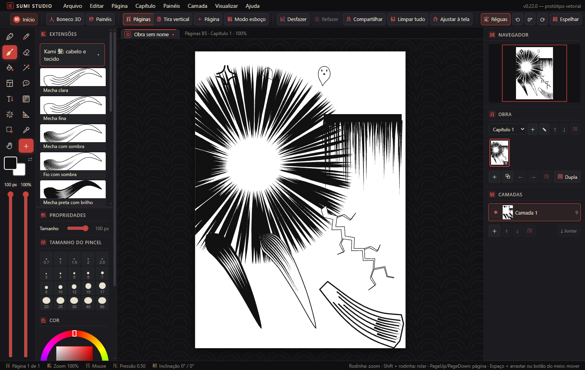
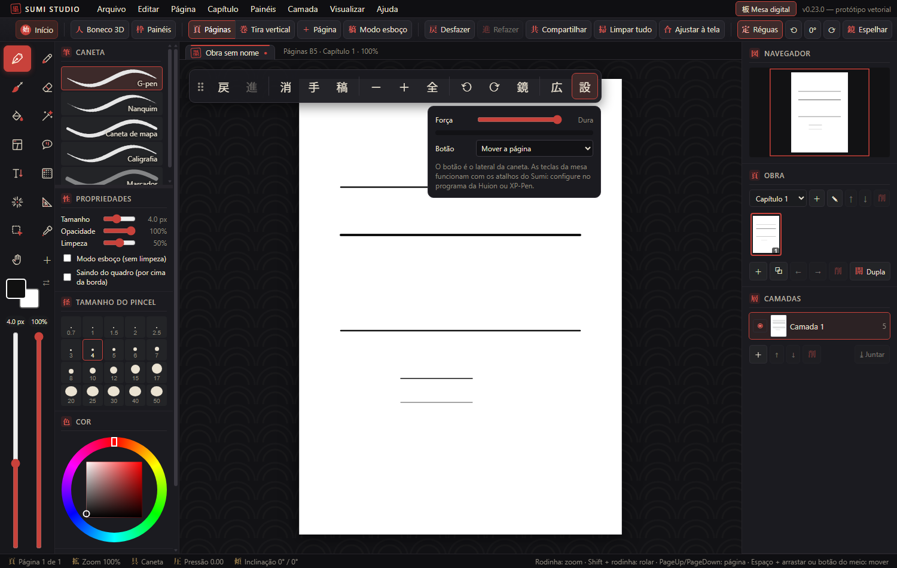
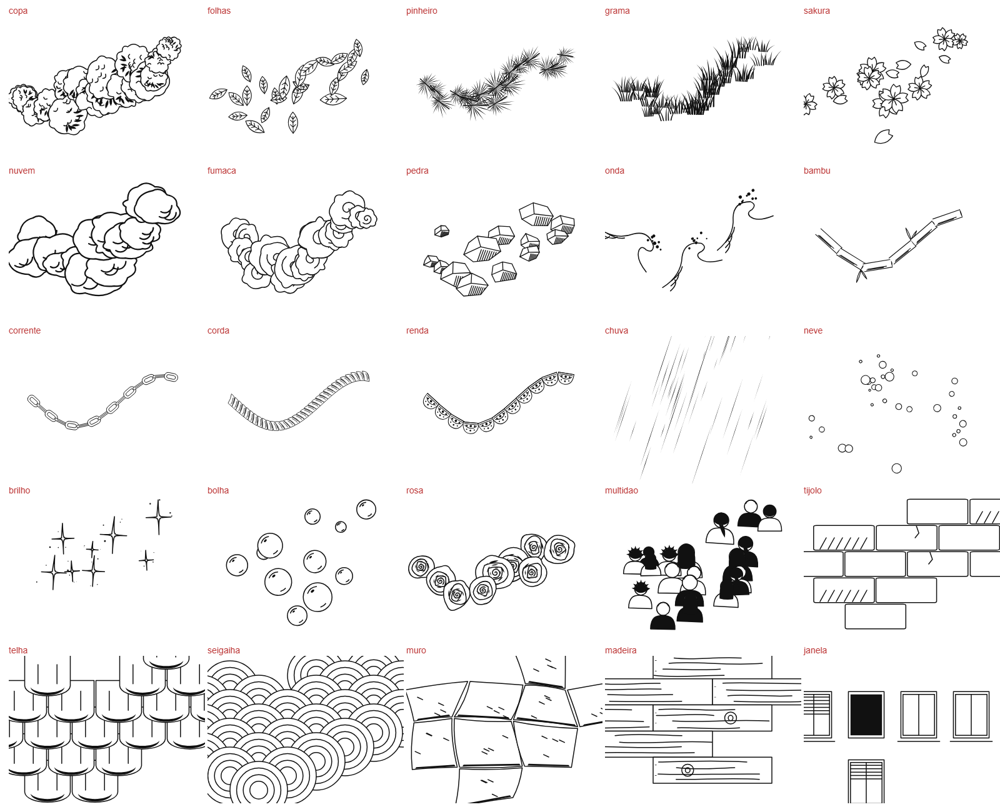

# Sumi Studio 墨工房

Programa de desenho de mangá para Windows, com site, loja de pacotes e trabalho em grupo. Todo o desenho é vetorial: a obra guarda traços, não pixels, e continua nítida em qualquer tamanho.

**Site:** https://sumi-studio-servidor.fly.dev

**Status:** em desenvolvimento e em fase de testes. A loja ainda não vende ao público.

## O que ele faz

- Pincéis que respondem à pressão da caneta, camadas, seleção e borracha vetorial
- Quadros de mangá, balões de fala, réguas de perspectiva e retículas
- Páginas e tira vertical, com exportação em PDF
- Boneco 3D para usar como referência de pose
- Modo Mesa digital, com barra própria para quem desenha direto na tela
- Obras compartilhadas para desenhar em grupo pela internet
- Conta com e-mail ou Google
- Loja no programa e no site, com moeda própria (Sumi Coin) e pagamento por InfinitePay
- Atualização automática com arquivos assinados

## Tecnologias

| Parte | Usado |
| --- | --- |
| Programa | Tauri 2, React 19, TypeScript, Vite |
| Desenho | Motor vetorial próprio em Canvas, Three.js no boneco 3D |
| Servidor | Node.js e WebSocket, hospedado no Fly.io |
| Site | HTML, CSS e JavaScript, servidos pelo mesmo servidor |

## Pincéis de cenário

Os padrões abaixo são desenhados por código ao longo do traço, sem usar imagens.

## Amostra do código

O código completo fica em repositório privado, porque inclui a loja e os pacotes vendidos. A pasta [`codigo`](codigo) traz uma parte real do motor de desenho, apenas para leitura. Ela não compila sozinha.

| Arquivo | O que faz |
| --- | --- |
| [`types.ts`](codigo/types.ts) | Estruturas da obra: traços, camadas e documento |
| [`cleanup.ts`](codigo/cleanup.ts) | Ao soltar a caneta, tira o tremido e transforma o traço em uma curva lisa |
| [`panels.ts`](codigo/panels.ts) | Quadros da página de mangá |
| [`rulers.ts`](codigo/rulers.ts) | Réguas de linha, curva, elipse e perspectiva, com o traço grudando nelas |
| [`tone.ts`](codigo/tone.ts) | Retículas |
| [`smartArea.ts`](codigo/smartArea.ts) | A partir de um clique, acha a região cercada pelos traços e devolve o contorno em vetor |

## Autor

Julio Guedes

© 2026 Julio Guedes. Todos os direitos reservados. Este código está aqui para consulta e não pode ser copiado, alterado ou redistribuído sem autorização.
